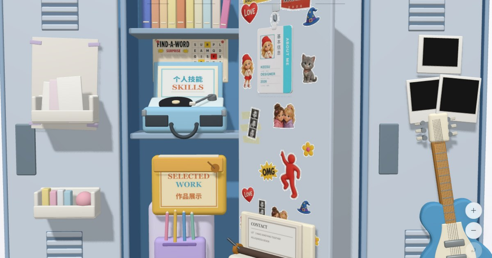

# AVA LI — PORTFOLIO '26

一个 **3D 储物柜风格** 的个人作品集网站。打开柜门，探索我的视觉设计、数据分析与影像作品。

**在线访问：** <https://jack028bot.github.io/locker-portfolio/>



---

## ✨ 网站亮点

- **3D 互动场景**：基于 WebGL 的储物柜主场景，支持缩放、视角复位，柜门可开合，贴纸可拖拽
- **四大内容板块**：
  - `ABOUT` — 个人信息工牌（点击柜门上的工牌或顶部导航）
  - `SKILLS` — 技能卡组：视觉设计 / 数据分析 / AI 工具应用
  - `SELECTED WORK` — 作品展示：海报设计、IP 形象、角色 PV、数据新闻、图文作品
  - `CONTACT` — 软木板留言板，打字机风格的便签互动
- **响应式与降级策略**：移动端自适应布局；不支持 WebGL / 设备性能不足 / 开启流量节省模式时自动切换静态版本
- **首屏加载管理**：关键资源预加载 + 进度指示，加载失败支持重试与降级继续

## 🛠️ 技术栈

| 类别 | 技术 |
|------|------|
| 框架 | React 19 |
| 3D 渲染 | three.js + react-three-fiber |
| 构建 | Vite |
| 部署 | GitHub Pages（main 分支自动部署） |

> **说明：** 本仓库存放的是**构建后的静态产物**（`index.html` + `assets/` 打包文件），
> 源码工程不在本仓库中。如需修改源码级功能，需要原始 Vite 工程重新构建后覆盖本仓库内容。

## 📁 仓库结构

```
locker-portfolio/
├── index.html              # 入口页（含 SEO meta、首屏预加载声明）
├── favicon.svg             # 网站图标
├── og-image.jpg            # 社交分享预览图（1200×630）
├── robots.txt              # 爬虫规则
├── sitemap.xml             # 站点地图
├── 404.html                # 404 兜底页（重定向回首页）
├── .nojekyll               # 跳过 GitHub Pages 的 Jekyll 处理，加快部署
└── assets/                 # Vite 打包产物
    ├── index-*.js/css      # 主包（React + 资源清单 + 场景逻辑）
    ├── *.js / *.css        # 按页面拆分的代码分包（AboutCard、ContactBoard 等）
    ├── obj/ obj2/          # 3D 场景物件贴图（工牌、贴纸、吉他、打字机等）
    ├── posters/            # 海报作品图（多分辨率 webp）
    ├── photo/              # 摄影作品图（多分辨率 webp）
    ├── mag/                # 杂志排版作品图
    └── cover/              # 视频/文章封面图
```

## 🚀 部署

仓库已启用 GitHub Pages（Source: `main` 分支根目录），推送到 `main` 后自动构建上线，无需手动操作。

本地预览：

```bash
# 在仓库根目录起一个静态服务器即可
python -m http.server 8080
# 然后访问 http://127.0.0.1:8080/
```

## 📝 修改内容须知

由于本仓库是构建产物，直接修改时请注意：

1. **文案**：分散在 `assets/index-*.js` 等打包文件中（压缩过的 JS 字符串），改动前先定位字符串
2. **图片**：替换 `assets/` 下的 webp 时保持**相同文件名与相近尺寸**即可生效；
   注意柜门上的贴图有部分**同时烘焙在 `assets/obj2/doorDecals.webp` 图集里**
   （工牌位于图集 (16,16) 处，尺寸 430×760），需要同步更新
3. **路径**：全站使用**相对路径**（`./assets/...`），新增引用不要以 `/` 开头，
   否则在 `https://jack028bot.github.io/locker-portfolio/` 子路径下会 404
4. **预加载清单**：`index.html` 里的 `<link rel="preload">` 与打包文件中的资源清单
   需保持一致，改了一边记得同步另一边

## 📄 版权

站点设计与作品版权归 © 2026 AVA LI 所有。
字体来自 [Google Fonts](https://fonts.google.com/)（OFL 开源授权）。
